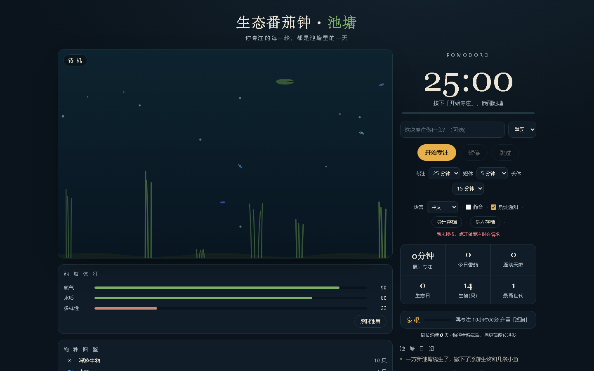

[中文](README.md) · **English**

# Eco-Pomodoro · 生态番茄钟

[](https://timyin7.github.io/Eco-Pomodoro/)
[](LICENSE)
[](index.html)

An **eco-friendly Pomodoro timer** where focus grows a living pond. Every completed session gives the plankton, weeds, fish, shrimp, tadpoles and koi something to live for: they grow, breed, age and die. The longer you focus, the more species unlock and the more complex the pond becomes.

**Zero dependencies · Single file · Works offline · No account · All data stays local.**

> **Live / accessible demo link:**
> <https://timyin7.github.io/Eco-Pomodoro/>
> Plain URL for screen readers and copy-paste: same address above. Keyboard users can `Tab` through controls and press `Space` to start or pause a focus session. If GitHub Pages is unavailable, double-click `index.html` in this repo to run it offline.



<!-- GIF placeholder: save a 20-30s recording as assets/demo.gif, then replace the image above with:

Suggested shot list: pick 5 minutes -> start focus -> pond shifts from warm daylight to a moonlit break -> show species guide progress. -->

---

## Concept

Most Pomodoro timers only tell you how long you sat there. Eco-Pomodoro gives that time a visible consequence:

- **Two clocks.** The animation always flows, but growth, hunger, breeding and death advance only with "eco time": ×1 while focusing, ×0.25 during breaks, frozen when idle or paused.
- **Honest accounting.** Only completed pomodoros add focus time. Pauses and skips count for nothing. The unlock curve (shrimp 1h, frogs 5h, koi 20h) uses exactly the same number as the stats panel.
- **A pond that can decline.** Overcrowded fish deplete oxygen; detritus pollutes the water. Focus restores health, or you can "Tend the pond" manually.
- **No punishment for stepping away.** While the page is suspended, eco time is back-computed from timestamps, capped at 30 minutes per catch-up so an overnight sleep cannot starve the whole pond.

It is closer to a quiet desktop aquarium than a streak tracker: no account, no leaderboard, no cloud sync, and no third-party telemetry.

---

## Features

### Pomodoro

- Full state machine: idle → focus → break → idle, with pause / resume / skip.
- A **long break starts automatically every 4 pomodoros**, in a repeating cycle.
- Durations: focus 5 / 15 / 25 / 45 / 60 minutes (default 25); short break 3 / 5 / 10; long break 10 / 15 / 20 / 30.
- Timing is based on `Date.now()` (`endAt`); it never drifts when backgrounded, screen-locked or refreshed, and recovers after a crash.
- Chime on completion plus browser notifications, with automatic in-page fallback when notifications are unavailable.
- `Space` starts focus when idle and pauses / resumes while running; ignored while an input, dropdown or button has focus.

### Eco pond

- Plankton, weeds, fish, shrimp, tadpoles / frogs and koi, with a juvenile → adult → elder life cycle.
- Hue inheritance: offspring inherit a parent's body color with slight mutations.
- Tadpoles metamorphose into frogs, hop onto lily pads and lay eggs; detritus sinks and feeds the shrimp.
- Vitals: oxygen, water quality and biodiversity, plus endangered warnings and a "Tend the pond" action with a 90-second cooldown.
- Species guide shows locked silhouettes and unlock progress; completing a focus session brings unlocked species back after extinction.

### Records and portability

- Task names and tags (Study / Work / Reading / Creation / Other), with per-tag statistics.
- Cumulative focus time, today's pomodoros, current and longest streaks, and pond-age ranks: Spring → Brook → Deep Pool → Lake → Ocean.
- Auto-saves to `localStorage` every 8 seconds and once more on close; versioned format, v1 migration, field validation and automatic backup on corruption.
- Export / import JSON; resetting the ecology creates a backup you can restore.
- Instant English / 中文 switch; language, mute and notification settings are device preferences stored separately from the pond save.

---

## Getting started

1. Open the [live demo](https://timyin7.github.io/Eco-Pomodoro/) or double-click the local `index.html`.
2. (Optional) Add a task name and pick a tag and focus duration.
3. Click **Start focus** or press `Space`.
4. Focus ends automatically in a break; the break returns to idle for the next pomodoro.

---

## Setup / Run locally

**Option 1: just open it**

```bash
# No install step, no dependencies
double-click index.html
```

**Option 2: local static server** (recommended — notifications and some browser features are restricted under `file://`)

```bash
npx serve .
# or
python -m http.server 8080
```

Then open <http://localhost:8080>.

---

## Feedback & contributing

- Bugs, ideas, screenshots and species proposals: open a [GitHub Issue](https://github.com/timyin7/Eco-Pomodoro/issues).
- Want to contribute code? Read [CONTRIBUTING.md](CONTRIBUTING.md) first. All tunable numbers live in `CONFIG` inside `index.html`.
- Repository metadata checklist: [REPO-SETUP.md](REPO-SETUP.md). Promotion and SEO notes: [PROMOTION-PLAN.md](PROMOTION-PLAN.md) and [SEO-RECOMMENDATIONS.md](SEO-RECOMMENDATIONS.md).

---

## Detailed rules

### Timer

- Full state machine: idle → focus → break → idle, with pause / resume / skip.
- **A long break starts automatically every 4 pomodoros**, in a repeating cycle.
- **Pause**: eco time freezes too; resuming picks up right where you paused.
- **Skip**: skips the current stage. A skipped focus earns **nothing** — no pomodoro count, no accumulated focus time; eco time already elapsed is still credited.
- `Space`: starts focus when idle, pauses / resumes while running; ignored while an input, dropdown or button has focus.
- Timing is based on `Date.now()` timestamps (`endAt`) and never drifts when backgrounded, screen-locked or refreshed. Crashes / refreshes resume from `endAt`, and anything that came due while you were away is credited retroactively.

### Pond

- **Two clocks**: the animation always flows, but growth, hunger, breeding and death advance only with eco time — ×1 while focusing, ×0.25 during breaks, frozen when idle or paused.
- **Away catch-up**: while the page is suspended, eco time is back-computed from elapsed wall-clock time, capped at 30 minutes per catch-up and digested frame by frame.
- **Vitals panel**: oxygen (weeds produce − creatures consume), water quality (detritus pollutes − shrimp purify) and biodiversity. "Tend the pond" adds oxygen +10, quality +12, scoops 30% of detritus, with a 90-second cooldown.
- **Species unlock** by cumulative real focus time: shrimp at 1h → tadpoles & frogs at 5h → koi at 20h. Locked species appear as silhouettes in the guide.
- **Ecological feedback**: a species down to its last member triggers a warning; completing a focus session calls unlocked species back.
- **Reset ecology**: two-step confirmation, automatic backup beforehand, and a "Restore backup" entry. Resetting clears only the ecology.

### Language and saves

- The **Language** dropdown at the left of the settings row switches between **English / 中文** immediately and remembers the choice. First-time users get a language guessed from the system locale.
- Language, mute and notifications are **device preferences**, stored separately from pond saves.
- Auto-saves to `localStorage` every 8 seconds and before close; corrupted saves are backed up and rebuilt.
- Export as JSON and import back are supported.

---

## File structure

```text
.
├── index.html                 # the app: structure + styles + all logic (inlined, single file)
├── assets/demo-screenshot.png # screenshot of the live demo
├── README.md                  # Chinese readme
├── README.en.md               # English readme
├── LICENSE                    # MIT
├── CONTRIBUTING.md            # contribution guide
├── REPO-SETUP.md              # repository settings checklist
├── PROMOTION-PLAN.md          # promotion plan
└── SEO-RECOMMENDATIONS.md     # SEO / Open Graph notes
```

The code is organized in four layers, all inside `index.html`'s `<script>`:

| Block | Responsibility |
|---|---|
| `CONFIG` | All tunable numbers (durations, caps, rates, unlock thresholds) in one place |
| `Creature` & subclasses | Creature base class plus `Fish` / `Shrimp` / `Tadpole` / `Frog` / `Koi` / `Weed` / `Pad` |
| `pond` | Ecology state, update & draw, save I/O, stats & unlocks |
| `pomo` | Pomodoro state machine, segmented time settlement, notifications & chime |

---

## Key designs

- **Timestamps, not frame counts.** The main loop only does "due check → settle → digest"; even if rAF stalls, `endAt` stays correct.
- **Eco time uses segmented settlement.** A time anchor plus a backlog queue `pendingEco`; elapsed time is settled at the pre-switch rate before every state change, and the main loop digests at most 300 eco-seconds per frame.
- **Accounting happens only on completion.** `totalFocusSec` is credited exclusively by `creditFocus()` when a pomodoro completes or is recovered after a crash.
- **Catch-up is capped.** At most 1800 eco-seconds (30 minutes) per catch-up.
- **High-DPI displays.** `ctx.setTransform(dpr, 0, 0, dpr, 0, 0)`; all creatures use CSS logical coordinates, with DPR capped at 2x.
- **Device preferences live apart from the pond save.** Language / mute / notifications are stored in a separate `prefs` key.

---

## Known limitations

- System notifications require HTTPS or `localhost`; under `file://` they automatically degrade to in-page toasts.
- While the page is suspended by the OS, no real-time notifications fire — everything is back-computed from timestamps when you return.
- Saves live in `localStorage`; clearing site data erases them. Use "Export save" regularly.

---

## License

[MIT](LICENSE) · Copyright (c) 2026 timyin7
