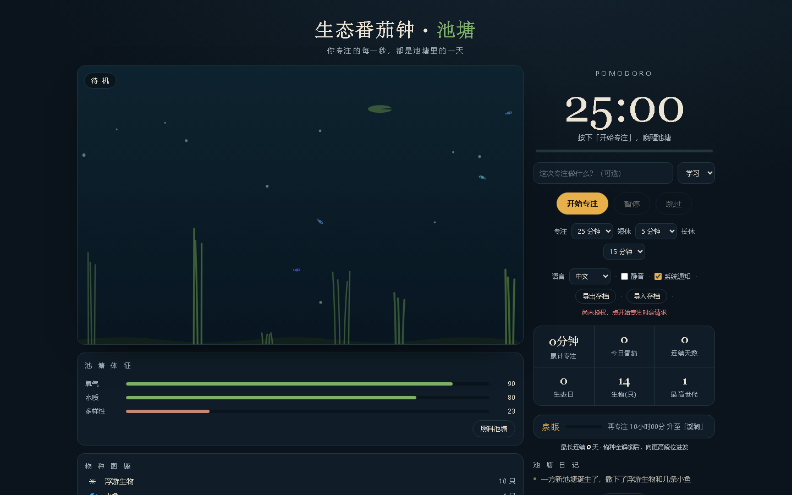

**中文** · [English](README.en.md)

# 生态番茄钟 · Eco-Pomodoro

[](https://timyin7.github.io/Eco-Pomodoro/)
[](LICENSE)
[](index.html)

一个把「专注」变成「生态演化」的 **eco-friendly Pomodoro timer**：每完成一次专注，池塘里的浮游生物、水草、鱼、虾、蝌蚪与锦鲤就会生长、繁衍、老年死亡；累计专注越久，解锁的物种越多，池塘也越复杂。

**零依赖 · 单文件 · 离线可用 · 无账号 · 数据只存在本地。**

> **在线演示（可直接访问 / accessible demo link）**：
> <https://timyin7.github.io/Eco-Pomodoro/>
> 纯文本链接同上；键盘用户可用 `Tab` 浏览控件、`空格` 开始 / 暂停专注。若 GitHub Pages 不可达，双击本仓库的 `index.html` 即可离线使用。



<!-- GIF 占位：将 20–30 秒录屏保存为 assets/demo.gif 后，把上面的静态图替换为：

建议镜头：选择 5 分钟 → 开始专注 → 池塘由暖阳光柱进入月夜休息 → 展示物种图鉴进度。 -->

---

## 它是什么 / Concept

传统番茄钟只记录「你坐了多久」。生态番茄钟给这段时间一个看得见的后果：

- **双时钟**：画面始终流动；但生长、饥饿、繁衍、死亡只随「生态时间」推进——专注 ×1，休息 ×0.25，待机 / 暂停冻结。
- **真实记账**：只有完成的番茄才累计专注时长；暂停和跳过都不计入。虾 1h、青蛙 5h、锦鲤 20h 的解锁曲线与统计面板严格同源。
- **会衰退的生态**：鱼口过密会缺氧，残骸堆积会污染水质；专注能恢复健康，也可以点「照料池塘」人工干预。
- **不惩罚忘记**：页面被系统挂起期间会按时间戳补算生态时间，单次封顶 30 分钟，不会因为睡了一觉就饿死整池生物。

它更像一个安静的电子水族箱，而不是一张打卡表：没有账号、没有排行榜、没有云端同步，也不会向第三方上报数据。

---

## 功能一览 / Features

### 番茄钟

- 完整状态机：待机 → 专注 → 休息 → 待机，支持暂停 / 继续 / 跳过。
- 每 **4 个番茄**自动进入长休息，循环往复。
- 时长可选：专注 5 / 15 / 25 / 45 / 60 分钟（默认 25）；短休息 3 / 5 / 10；长休息 10 / 15 / 20 / 30。
- 基于 `Date.now()` 的 `endAt` 计时；切后台、锁屏、刷新不漂移，崩溃后按时间戳恢复并补记。
- 到点提示音 + 浏览器系统通知；通知不可用时自动降级为页面内提示。
- `空格`：待机时开始专注，计时中暂停 / 继续；输入框、下拉、按钮聚焦时不劫持。

### 生态池塘

- 浮游生物、水草、鱼、虾、蝌蚪 / 青蛙、锦鲤；完整生命周期：幼体 → 成年 → 老年。
- 体色遗传：子代继承亲本色相并轻微变异。
- 蝌蚪变态成青蛙、跳上荷叶、再产卵；残骸沉底喂虾，形成物质循环。
- 体征面板：氧气、水质、生物多样性；濒危提示与「照料池塘」干预（90 秒冷却）。
- 物种图鉴显示锁定剪影与解锁进度；灭绝后完成一次专注可唤回已解锁物种。

### 记录与便携性

- 任务名与标签（学习 / 工作 / 阅读 / 创作 / 其他），按标签统计。
- 累计专注、今日番茄、连续天数、最长纪录、池龄段位（泉眼 → 溪涧 → 深潭 → 湖泊 → 汪洋）。
- 每 8 秒自动存 `localStorage`，关闭前再存一次；版本化存档 + v1 迁移 + 逐字段校验，损坏自动备份重建。
- 支持导出 / 导入 JSON；重置生态前自动备份，并可恢复。
- 界面语言 English / 中文 即时切换；语言、静音、通知属于设备偏好，与池塘存档分离。

---

## 快速开始 / Getting started

1. 打开[在线演示](https://timyin7.github.io/Eco-Pomodoro/)，或双击本地 `index.html`。
2. （可选）填写任务名、选择标签与专注时长。
3. 点击 **开始专注** 或按 `空格`。
4. 专注结束会自动进入休息；休息结束回到待机，等待下一个番茄。

---

## 本地运行 / Setup

**方式一：直接打开**

```bash
# 无需安装任何依赖
双击 index.html
```

**方式二：本地静态服务器**（推荐；系统通知与部分浏览器特性在 `file://` 下受限）

```bash
npx serve .
# 或
python -m http.server 8080
```

然后访问 <http://localhost:8080>。

---

## 反馈与贡献 / Feedback & contributing

- 问题、想法、截图与物种提案：优先提交 [GitHub Issue](https://github.com/timyin7/Eco-Pomodoro/issues)。
- 想改代码？先读 [CONTRIBUTING.md](CONTRIBUTING.md)；所有可调数值都在 `index.html` 的 `CONFIG` 中。
- 仓库元数据的填写清单见 [REPO-SETUP.md](REPO-SETUP.md)；推广与 SEO 资料见 [PROMOTION-PLAN.md](PROMOTION-PLAN.md) 与 [SEO-RECOMMENDATIONS.md](SEO-RECOMMENDATIONS.md)。

---

## 详细规则 / Rules

### 计时规则

- 完整状态机：待机 → 专注 → 休息 → 待机，支持暂停 / 继续 / 跳过。
- **每 4 个番茄自动进入长休息**，循环往复。
- **暂停**：生态时间同步冻结，恢复后从暂停点继续。
- **跳过**：跳过当前阶段。跳过的专注**不产生任何收益**——不计番茄数、不累计专注时长；已流逝的生态时间仍然入账。
- `空格`：待机时开始专注，计时中暂停 / 继续；输入框、下拉、按钮聚焦时不劫持。
- 计时基于 `Date.now()` 时间戳（`endAt`），切后台、锁屏、刷新都不漂移；崩溃 / 刷新后按 `endAt` 恢复，离开期间到点会补记。

### 池塘规则

- **双时钟**：画面动画永远在流动；但成长、饥饿、繁衍、死亡只随「生态时间」推进——专注时 ×1 全速，休息时 ×0.25 慢速，待机 / 暂停时凝固。
- **离开补算**：页面被挂起期间按经过时间补算生态时间，单次封顶 30 分钟（分帧消化，不会一次跳变把生物饿死）。
- **体征面板**：氧气（水草产氧 − 生物耗氧）、水质（残骸污染 − 虾净化）、生物多样性。鱼口过密会缺氧，残骸堆积会让水质变差；专注能恢复健康，「照料池塘」（氧气 +10、水质 +12、清 30% 残渣，冷却 90 秒）可以人工干预。
- **物种解锁**按累计真实专注时长：虾 1h → 蝌蚪与青蛙 5h → 锦鲤 20h。未解锁物种在图鉴中显示为剪影。
- **生态反馈**：生物仅剩一只时触发濒危提示；物种灭绝不是终点——完成一次专注会唤回已解锁的物种。
- **重置生态**：两步确认（第一次点击进入待确认态，3 秒内再点执行），执行前自动备份，提供「恢复备份」入口。重置只清生态，累计专注、番茄数、历史纪录全部保留。

### 界面语言与存档

- 设置行最左侧的 **Language** 下拉可切换 **English / 中文**，立即生效并记住选择；新用户首次打开会按系统语言自动选择。
- 语言、静音、通知属于**设备偏好**，独立存储，不随池塘存档的导出 / 导入 / 恢复而变化。
- 每 8 秒自动存 `localStorage`，关闭页面前再存一次；版本化存档 + v1 自动迁移 + 逐字段校验，损坏时自动备份并重建。
- 支持**导出为 JSON** 与**导入还原**，可用于跨设备迁移。

---

## 文件结构

```text
.
├── index.html                 # 应用本体：结构 + 样式 + 全部逻辑（内联，单文件）
├── assets/demo-screenshot.png # 在线演示截图
├── README.md                  # 中文说明
├── README.en.md               # English readme
├── LICENSE                    # MIT
├── CONTRIBUTING.md            # 贡献指南
├── REPO-SETUP.md              # 仓库设置清单
├── PROMOTION-PLAN.md          # 推广方案
└── SEO-RECOMMENDATIONS.md     # SEO / Open Graph 建议
```

代码分四层，均在 `index.html` 的 `<script>` 内：

| 区块 | 职责 |
|---|---|
| `CONFIG` | 全部可调数值（时长、上限、速率、解锁阈值）集中在此 |
| `Creature` 及其子类 | 生物基类与 `Fish` / `Shrimp` / `Tadpole` / `Frog` / `Koi` / `Weed` / `Pad` |
| `pond` | 生态状态、更新与绘制、存档读写、统计与解锁 |
| `pomo` | 番茄钟状态机、区间结算、通知与提示音 |

---

## 几个关键设计

- **计时以时间戳为准，不靠帧计数。** 主循环只做「到点检测 → 结算 → 消化」，即使 rAF 停摆，`endAt` 仍然正确。
- **生态时间走区间结算。** 时间锚点 + 待消化队列 `pendingEco`：状态切换前先按切换前的速率结算已流逝时间；主循环每帧最多消化 300 生态秒。
- **记账只发生在完成时。** `totalFocusSec` 仅由 `creditFocus()` 在番茄完成（或崩溃补记）时一次性计入。
- **离开期间的补算有上限。** 单次最多 1800 生态秒（30 分钟），避免休眠一夜后一次跳变把生物全部饿死。
- **高分屏。** `ctx.setTransform(dpr, 0, 0, dpr, 0, 0)`，生物一律使用 CSS 逻辑坐标，DPR 封顶 2x。
- **设备偏好与池塘存档分离。** 语言 / 静音 / 通知存在独立的 `prefs` 键里。

---

## 已知限制

- 系统通知需要 HTTPS 或 `localhost`；`file://` 下自动降级为页面内提示。
- 页面被系统挂起期间不会有实时通知，回到页面时按时间戳补算与补记。
- 存档在 `localStorage`，浏览器清理站点数据会丢失——建议定期用「导出存档」留底。

---

## 许可

[MIT](LICENSE) · Copyright (c) 2026 timyin7
